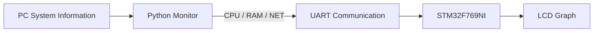
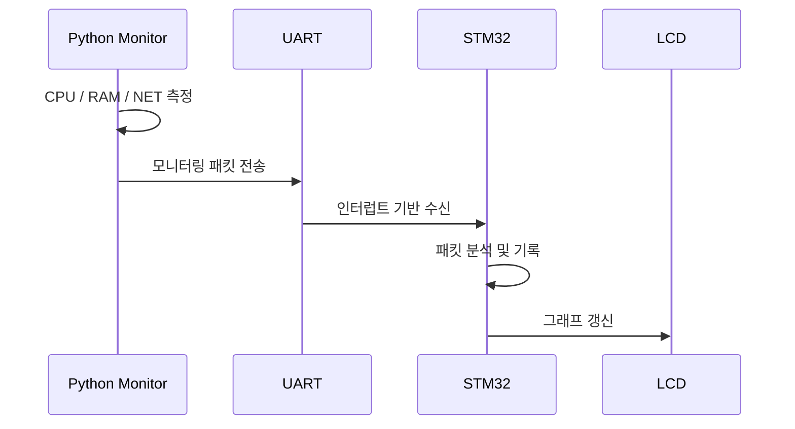

# STM32 PC Monitor

PC의 CPU, RAM 및 네트워크 사용량을 STM32 보드로 전송하여 LCD 그래프로 표시하는 시스템 모니터링 프로젝트입니다.

## 주요 기능

- CPU 및 RAM 사용률 모니터링
- 네트워크 송수신량 측정
- UART 기반 데이터 전송
- LCD 실시간 그래프 출력
- FreeRTOS 기반 데이터 처리

## 시스템 구성



PC에서 수집한 시스템 정보를 다음 형식으로 STM32에 전달합니다.

```text
$CPU:35,RAM:62,NET:120#
```

STM32는 수신한 데이터를 분석하고 최근 측정값을 저장하여 LCD에 그래프로 표시합니다.

## 개발 환경

### Hardware

- STM32F769I-DISCO
- STM32F769NI
- 800 × 480 LCD
- UART 통신 환경

### Firmware

- STM32CubeIDE
- STM32 HAL
- FreeRTOS
- C

### PC

- Python 3
- `psutil`
- `pyserial`

## 실행 방법

1. PC와 STM32 보드를 UART로 연결합니다.
2. STM32 펌웨어를 빌드하여 보드에 업로드합니다.
3. 필요한 Python 패키지를 설치합니다.

```bash
pip install psutil pyserial
```

4. `PCtoMCU/send.py`에서 사용 환경에 맞는 시리얼 포트를 설정합니다.
5. Python 프로그램을 실행합니다.

```bash
python PCtoMCU/send.py
```

## 프로젝트 구조

```text
stm32-pc-monitor
├── Core/          # STM32 초기화 및 FreeRTOS 태스크
├── USER/          # 패킷 처리, 데이터 기록 및 LCD UI
├── PCtoMCU/       # PC 시스템 정보 전송 프로그램
├── Drivers/       # STM32 HAL 및 보드 드라이버
└── Middlewares/   # FreeRTOS 구성 요소
```

## 데이터 처리 흐름



## 향후 확장 방향

- PC 환경에 따른 통신 설정 지원
- 패킷 처리 및 데이터 검증 강화
- 연결 상태와 통신 오류 표시
- 시스템 정보 항목 확장
- 태스크 간 데이터 전달 구조 개선
- LCD 화면과 그래프 표현 방식 개선
- 장시간 실행 환경을 고려한 안정성 보강
